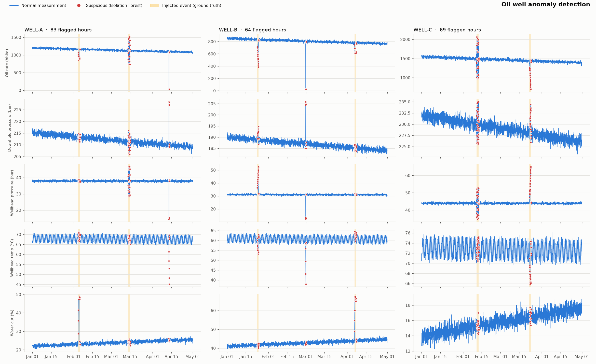

# Oil Well Anomaly Detector

Neft quyularının ölçmə datasında (hasilat, təzyiq, temperatur, su payı) qeyri-adi davranışı **Isolation Forest** ilə aşkarlayan və araşdırılmalı müşahidələri CSV hesabatına yazan layihə.



## Məqsəd

Quyuda baş verən arzuolunmaz hadisələr — suyun kəskin artması, klapanın özbaşına bağlanması, slugging, hidrat tıxacı — ölçmələrdə əvvəlcə kiçik sapmalar kimi görünür. Operator yüzlərlə saatlıq ölçməni gözlə izləyə bilmir. Bu layihə:

1. ölçmə datasını təmizləyir (dublikatlar, boşluqlar, sensor xətaları),
2. hər quyunun **öz normal davranışını** öyrənir,
3. normadan kənara çıxan ölçmələri işarələyir və **səbəbini** göstərir,
4. mühəndisin araşdırması üçün prioritetləşdirilmiş CSV hesabat hazırlayır.

## Layihənin quruluşu

```
oilgas/
├── data/
│   └── sample_data.csv               # sintetik ölçmələr (3 quyu × 120 gün, saatlıq)
├── notebooks/
│   └── anomaly_detection.ipynb       # addım-addım analiz
├── src/
│   └── detector.py                   # bütün pipeline + CLI
├── outputs/
│   ├── anomaly_plot.png              # normal vs şübhəli ölçmələr
│   ├── suspicious_observations.csv   # şübhəli hər saat, səbəbi ilə
│   └── anomaly_episodes.csv          # ardıcıl şübhəli saatlar epizodlara birləşdirilib
├── requirements.txt
└── README.md
```

## Quraşdırma

```bash
python3 -m venv .venv
source .venv/bin/activate
pip install -r requirements.txt
```

## İstifadə

```bash
# sintetik datanı yenidən yarat və analiz et
python src/detector.py --generate

# mövcud data/sample_data.csv-ni analiz et
python src/detector.py

# öz datanı analiz et
python src/detector.py --input path/to/measurements.csv --contamination 0.02

# notebook
jupyter notebook notebooks/anomaly_detection.ipynb
```

Öz datan üçün CSV-də bu sütunlar olmalıdır: `timestamp`, `well_id` və aşağıdakı metriklərdən istənilən hissəsi. `event_type` sütunu (əgər varsa) yalnız qiymətləndirmə üçün istifadə olunur.

| Sütun | Məna | 3W ekvivalenti |
|---|---|---|
| `oil_rate_bpd` | neft hasilatı, barrel/gün | — |
| `downhole_pressure_bar` | quyudibi təzyiq | `P-PDG` |
| `wellhead_pressure_bar` | quyuağzı təzyiq | `P-TPT` |
| `wellhead_temp_c` | quyuağzı temperatur | `T-TPT` |
| `water_cut_pct` | su payı (BSW), % | — |

## Data

[3W Dataset](https://github.com/petrobras/3W) (Petrobras) neft quyularında arzuolunmaz hadisələrin aşkarlanması üçün açıq datasetdir. Bu layihədəki sintetik data onun hadisə siniflərindən ilhamlanıb:

| Hadisə | 3W sinfi | Datada izi |
|---|---|---|
| `water_breakthrough` | 1 — Abrupt Increase of BSW | su payı +22–30 faiz bəndi, hasilat düşür |
| `dhsv_closure` | 2 — Spurious Closure of DHSV | hasilat ≈0, quyuağzı təzyiq düşür, quyudibi təzyiq qalxır, temperatur soyuyur |
| `severe_slugging` | 3 — Severe Slugging | təzyiq və hasilatda güclü salınmalar |
| `hydrate_restriction` | 8 — Hydrate in Production Line | quyuağzı təzyiq tədricən artır, hasilat və temperatur düşür |

Normal davranışa təbii hasilat azalması, su payının yavaş artımı, sutkalıq temperatur dövrü və ölçmə küyü daxildir. Real SCADA datasını təqlid etmək üçün dataya qəsdən **255 boş dəyər, 25 dublikat sətir və 12 sensor xətası** (9999 bar, −1 bbl/d, 120% su payı) əlavə olunub.

## Metod

1. **Təmizləmə** — dublikatlar silinir; fiziki olaraq mümkün olmayan dəyərlər `NaN` edilir; ≤3 saatlıq boşluqlar zamana görə interpolyasiya olunur.
2. **Xüsusiyyətlər** — hər metrik üçün:
   - son 7 günün medianından sapma (təbii azalma anomaliya sayılmasın deyə),
   - 1 saatlıq dəyişmə (kəskin sıçrayışlar),
   - 6 saatlıq standart sapma (salınmalar, slugging).

   Hamısı **hər quyu üçün ayrıca** robust z-score (median/IQR) ilə miqyaslanır: 850 bbl/d bir quyu üçün normaldır, digəri üçün çöküşdür.
3. **Isolation Forest** — 300 ağac, `contamination=0.025`. Nəzarətsiz (unsupervised) modeldir, etiket tələb etmir.
4. **İzah** — hər şübhəli saat üçün ən çox sapan 3 xüsusiyyət `reason` sütununa yazılır.
5. **Epizodlar** — arasında ≤2 saat fasilə olan şübhəli saatlar bir epizoda birləşdirilir.

## Nümunə nəticə

Sintetik data üzərində (8640 saat, 8 hadisə):

| Göstərici | Dəyər |
|---|---|
| Aşkarlanan hadisələr | **8 / 8** |
| Precision (saat səviyyəsində) | 0.82 |
| Recall (saat səviyyəsində) | 0.88 |
| Şübhəli saat / epizod | 216 / 9 |

`outputs/anomaly_episodes.csv`-dən ilk sətirlər:

| Quyu | Başlanğıc | Saat | Əsas səbəb | Real hadisə |
|---|---|---|---|---|
| WELL-B | 2025-02-28 21:00 | 9 | hasilat volatilliyi ↑, hasilat ↓ | DHSV bağlanması |
| WELL-A | 2025-04-13 04:00 | 10 | hasilat volatilliyi ↑, hasilat ↓ | DHSV bağlanması |
| WELL-C | 2025-02-11 04:00 | 43 | quyuağzı təzyiq volatilliyi ↑ | slugging |
| WELL-B | 2025-01-23 16:00 | 28 | quyuağzı təzyiq volatilliyi ↑ | hidrat |
| WELL-A | 2025-02-04 07:00 | 34 | su payı ↑ | su keçməsi |

`suspicious_observations.csv`-də hər şübhəli saat üçün `priority` (high/medium), `anomaly_score`, bütün ölçmələr və `reason` var — araşdırmaya yuxarıdan aşağı başlamaq kifayətdir.

## Məhdudiyyətlər

- **Data sintetikdir.** Hadisələr aydın və təmiz modelləşdirilib; real datada nəticələr xeyli zəif ola bilər. Yuxarıdakı metriklər real performansı göstərmir.
- **`contamination` əl ilə seçilir.** 0.025 sintetik dataya uyğunlaşdırılıb; real data üçün tarixi hadisələrə əsasən yenidən seçilməlidir. Çox yüksək dəyər yalançı həyəcanları, çox aşağı dəyər buraxılmış hadisələri artırır.
- **Hadisənin növü təyin edilmir.** Model yalnız "bu normal deyil" deyir; `reason` sütunu istiqamət verir, amma diaqnoz mühəndisindir. Növü təyin etmək üçün 3W etiketləri ilə supervised model lazımdır.
- **Uzun, yavaş dəyişikliklər** 7 günlük baza xəttinə "uyğunlaşır" və bir neçə gündən sonra normal sayılır (məs. su payının tədricən artması).
- **Tək nöqtəli sensor sıçrayışları** təmizləmədə silinir, ona görə də sensor nasazlığı ayrıca aşkarlanmır.
- **Model bütün dövr üzərində öyrədilir** (offline/retrospektiv analiz). Real vaxt rejimi üçün yalnız keçmiş data ilə öyrədib, yeni ölçmələri ona görə qiymətləndirmək lazımdır.
- 3W datasının özündə hasilat və su payı birbaşa ölçülmür; real 3W ilə işləmək üçün sütunları yuxarıdakı cədvələ görə uyğunlaşdırmaq (və Pa → bar çevirmək) lazımdır.
